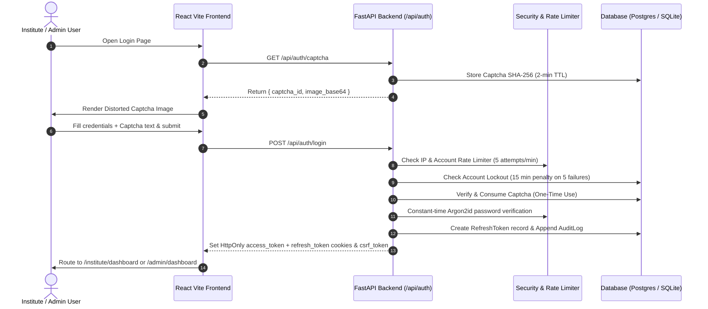

# AICTE SmartVerify AI - System Architecture

## 1. Overview
AICTE SmartVerify AI is an enterprise-grade artificial intelligence platform designed to automate the validation, scrutiny, and anomaly detection of technical institution approval applications across India.

Step 1 provides the foundational Identity, Credential & Session Management Layer (RBAC, MFA/Captcha, Audit Logging, and Token Security). Subsequent steps build upon this foundation to ingest application filings, run OCR text & table extraction, detect forged documents, and present verification results on dedicated dashboards.

---

## 2. Monorepo Structure & Extensibility

```
/
├── .env.example                     # Environment template
├── docker-compose.yml               # Multi-container Postgres + Backend + Frontend
├── README.md                        # Quickstart, API documentation, and verification
├── docs/
│   ├── ARCHITECTURE.md              # System design & module integration points
│   └── SECURITY.md                  # Security model, cryptographic policies & audit trail
├── backend/
│   ├── alembic/                     # Database migrations
│   ├── app/
│   │   ├── api/
│   │   │   ├── deps.py              # RBAC & token injection dependencies
│   │   │   └── v1/
│   │   │       ├── auth.py          # Step 1: Authentication & Session routes
│   │   │       ├── applications.py  # [Step 2 Plug-in point]
│   │   │       └── documents.py     # [Step 2 Plug-in point]
│   │   ├── models/                  # SQLAlchemy ORM models
│   │   │   ├── user.py              # User entity with lockout & attempts
│   │   │   ├── institute.py         # AICTE Institute registry
│   │   │   ├── refresh_token.py     # Server-side revocable token storage
│   │   │   ├── captcha.py           # 2-min one-time challenge store
│   │   │   └── audit_log.py         # Append-only tamper-proof audit trail
│   │   ├── schemas/                 # Pydantic v2 validation contracts
│   │   ├── security/                # Argon2id, JWT, Rate Limiting, CSRF, Captcha
│   │   ├── services/                # Business logic & services
│   │   └── scripts/
│   │       └── seed.py              # Synthetic seed fixture script
│   └── tests/                       # Pytest test suite
└── frontend/
    ├── public/
    │   └── inst1.jpg                # AICTE Headquarters aerial background
    └── src/
        ├── api/                     # Axios instance with 401 handling & CSRF
        ├── components/              # TricolourStrip, TabSlider, InputField, CaptchaField
        ├── context/                 # AuthContext session provider
        ├── pages/
        │   ├── LoginPage.tsx        # High-fidelity desktop & mobile login page
        │   ├── RegisterPage.tsx     # Onboarding stub
        │   ├── InstituteDashboard.tsx # Authenticated Institute Portal
        │   └── AdminDashboard.tsx   # Authenticated Central Admin Portal
        └── types/                   # TypeScript interfaces
```

---

## 3. Data Flow: Authentication & Session Cycle



---

## 4. How Subsequent Modules Will Plug In

| Step / Module | Backend Extension Point | Frontend Extension Point |
| :--- | :--- | :--- |
| **Step 1 (Current)** | `backend/app/api/v1/auth.py`, `models/`, `security/` | `/login`, `/institute/dashboard`, `/admin/dashboard` |
| **Step 2 (Documents & Ingestion)** | Mount `app/api/v1/documents.py`, create `Document` & `Application` models | Multi-file uploader with progress in Institute Dashboard |
| **Step 3 (OCR & Extraction)** | Asynchronous Celery / BackgroundTasks worker in `app/services/ocr.py` | Document viewer with extracted fields & bounding boxes |
| **Step 4 (Anomaly Detection)** | AI verification engine in `app/services/validation.py` | Admin Scrutiny Panel with risk score & flagged discrepancies |
| **Step 5 (Approval Workflow)** | State machine in `app/services/workflow.py` with RBAC | Approval/Rejection issuance with digital audit certificates |

